<p align="center">
  <a href="https://github.com/jmorton06/Lumos/">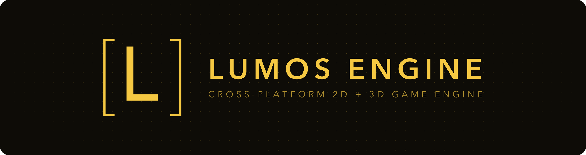</a>
</p>
<h3 align="center">Written in C++, with Lua scripting and a built-in editor.</h3>
<p align="center">
  <a href="#made-with-lumos">Made with Lumos</a> |
  <a href="#screenshots">Screenshots</a> |
  <a href="#features">Features</a> |
  <a href="#building">Building</a> |
  <a href="#documentation">Docs</a> |
  <a href="#dependencies">Dependencies</a>
<br/>
<br/>
<a href="https://actions-badge.atrox.dev/jmorton06/Lumos/goto?ref=main"></a>
<a href="https://github.com/jmorton06/Lumos/releases/latest"></a>
<a href="https://github.com/jmorton06/Lumos/blob/main/LICENSE"></a>
<br/>
<a href=""></a>
<a href="https://github.com/jmorton06/Lumos/releases"></a>
<a href="https://discord.gg/n9PDrNjJwt"></a>
<a href="https://ko-fi.com/Jmorton06"></a>
<a href="https://joem.app/lumos/docs"></a>
<br/>
</p>

## Made with Lumos

Everything below is a Lumos project written in Lua: no engine code of its own, exported to desktop and iOS with the same prebuilt templates.

### Orion

A space trading and exploration game set among the real stars of the HYG catalogue. Haul cargo between ports, build outposts, take on jobs and work your way home.

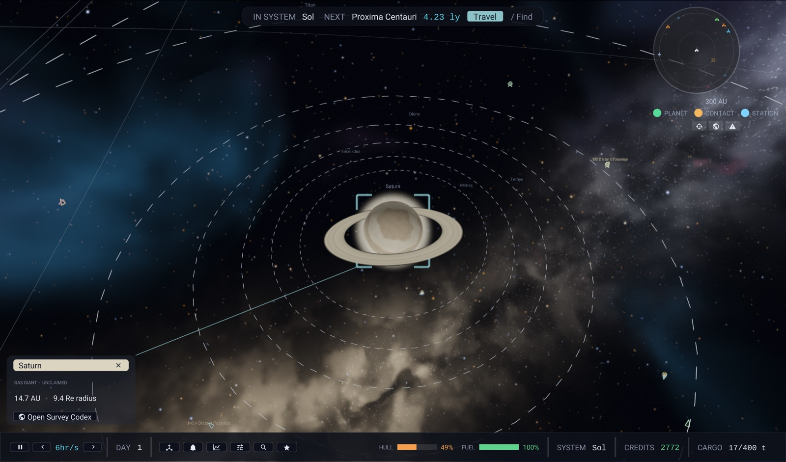

<table>
  <tr>
    <td>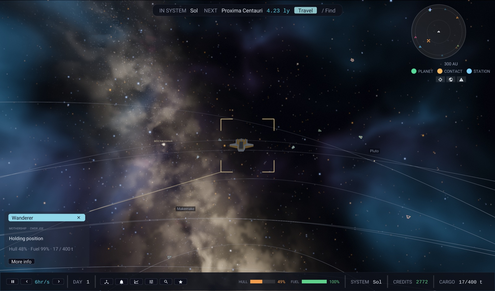</td>
    <td>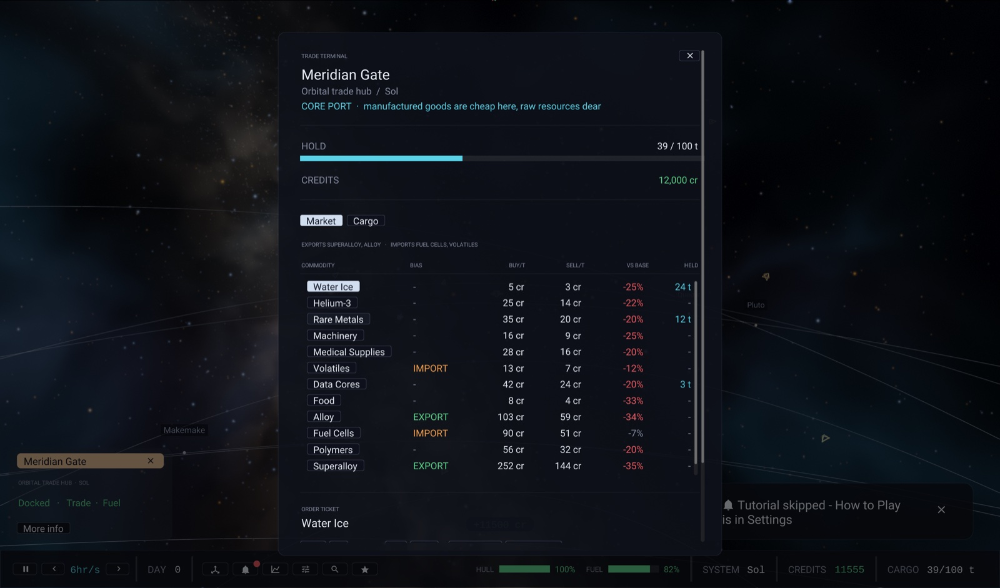</td>
  </tr>
</table>

### Planet Archery

A portrait arcade game: read the wind and the gravity, then shoot your way across the solar system. Included in [ExampleProject](ExampleProject) as the `Archery` scene.

<table>
  <tr>
    <td>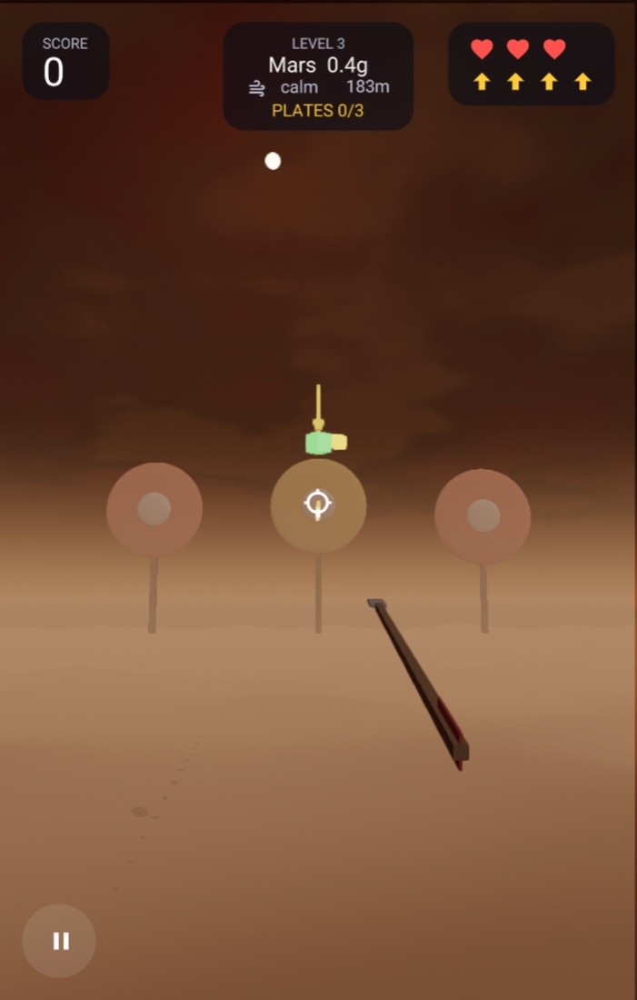</td>
    <td>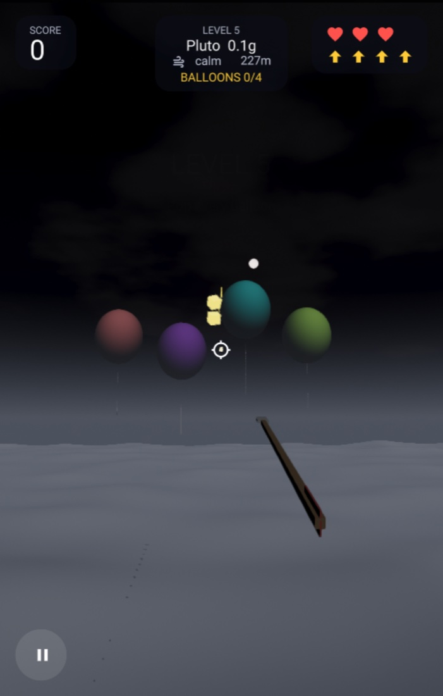</td>
    <td>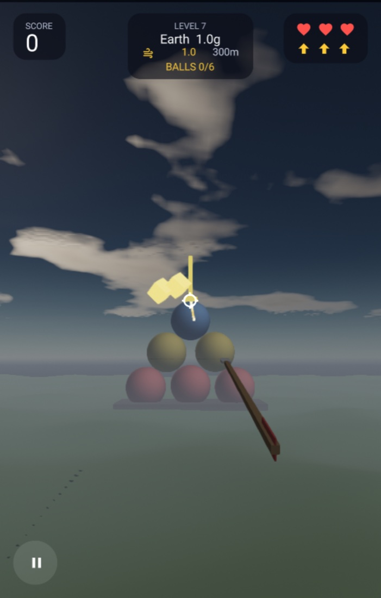</td>
  </tr>
</table>

### Vielle

[Vielle](https://joem.app/vielle) plays your own music, audiobooks and podcasts on iPhone, iPad and Mac. No account, no tracking, no subscription. Not a game: the whole app is built on the engine's UI. Source in [Tools/LumosTunes](Tools/LumosTunes).

<table>
  <tr>
    <td>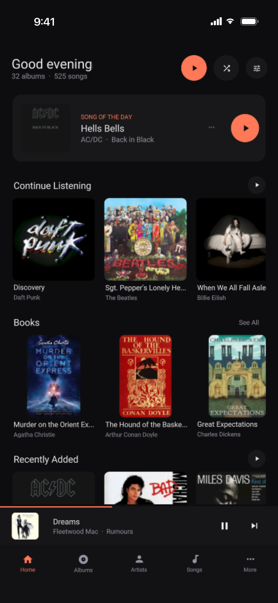</td>
    <td>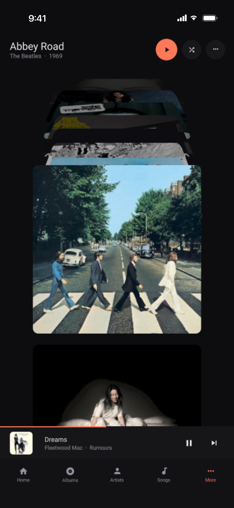</td>
    <td>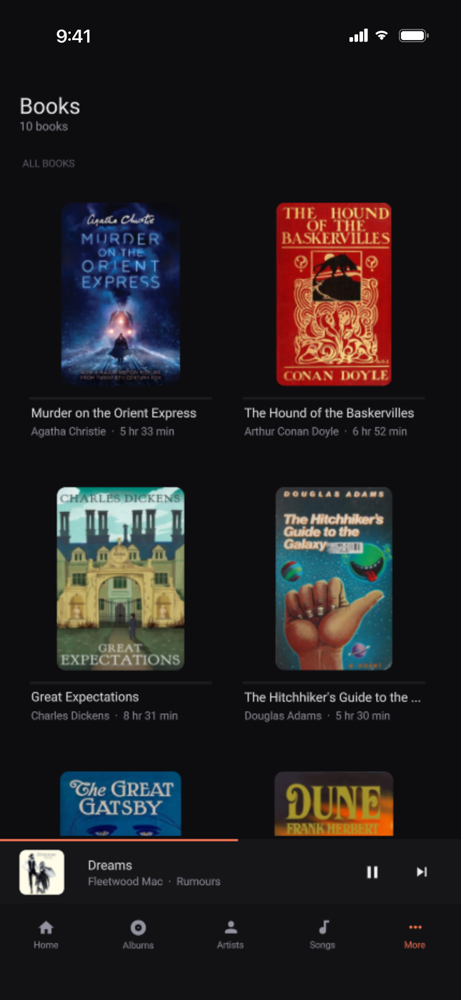</td>
  </tr>
</table>

## Screenshots

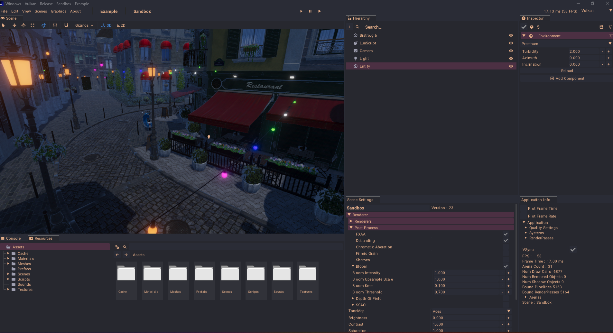
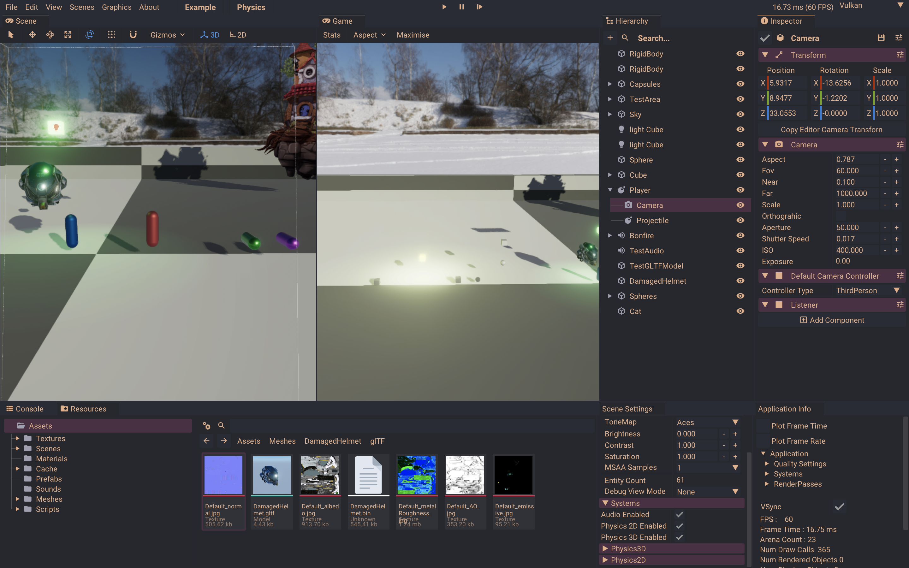
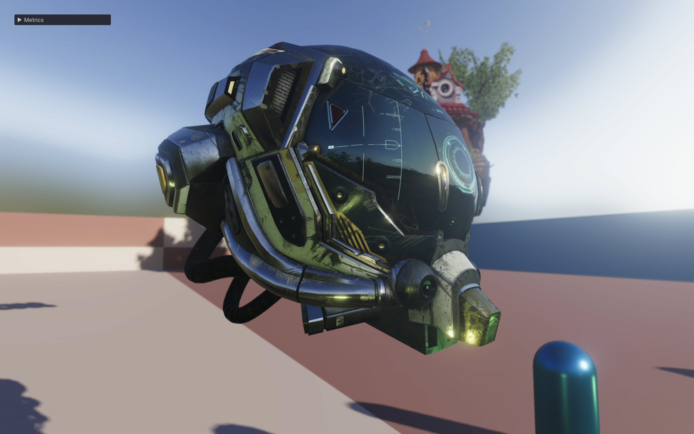
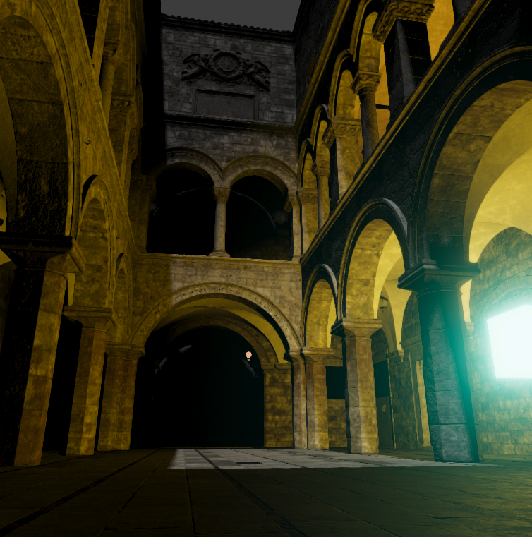

## Features

**Platforms**
* Windows, Linux, macOS and iOS, with partial Android support.
* Export a project without compiling the engine, using prebuilt templates (`Scripts/lumos export`).

**Rendering**
* Vulkan renderer (MoltenVK on Apple platforms) with Forward+ PBR shading.
* Cascaded and spot light shadows, SSAO, screen-space reflections, bloom, depth of field.
* TAA, SMAA and FXAA.
* Probe-based global illumination, volumetric fog, decals and a physical procedural sky.
* Frame Explorer: step through a frame pass by pass, with an explanation of each.

**Physics**
* 3D: custom engine with island solver, continuous collision, constraints and mesh colliders.
* 2D: Box2D.

**Scripting**
* Lua with hot reload and per-script environments.
* Scripted test harness that drives real input and takes screenshots (`--test=`).

**Editor**
* Dockable panels, command palette, undo, gizmos and asset browser, all on the engine's own UI.
* Built-in sprite editor, code editor and project hub.
* Runs on iOS with a touch layout.

**Audio**
* 3D audio with OpenAL.
* Software synth and sampler, audio analysis and streaming.

**Core**
* EnTT entity-component system, virtual file system, arena allocators and a job system.
* Tracy profiling.
* In-game debug overlay and fly camera, available to any game.

## Building

```
git clone https://github.com/jmorton06/Lumos.git
git submodule update --init --recursive
```

Install the [Vulkan SDK](https://vulkan.lunarg.com/).

#### Linux
```
sudo apt-get install -y g++-11 libxrandr-dev libxinerama-dev libxcursor-dev libxi-dev libopenal-dev mesa-common-dev
cd Lumos
Tools/linux/premake5 gmake2
make -j$(nproc) # config=release
```

#### Windows
Run `Scripts/Windows/GenerateVS22.bat` to generate a Visual Studio project.
```
cd Lumos
msbuild /p:Platform=x64 /p:Configuration=Release Lumos.sln
```

#### Mac
```
cd Lumos
Tools/premake5 xcode4
xcodebuild -project Runtime.xcodeproj
```

Apple silicon Macs may need:
```
cd Lumos
Tools/premake5 xcode4 --arch=arm64 --os=macosx
xcodebuild -project Runtime.xcodeproj
```

#### iOS
```
cd Lumos
Tools/premake5 xcode4 --os=ios
xcodebuild -project Runtime.xcodeproj CODE_SIGN_IDENTITY="" CODE_SIGNING_REQUIRED=NO CODE_SIGNING_ALLOWED=NO
```

To run on Apple devices with Vulkan (MoltenVK), disable Metal API Validation: Product > Scheme > Edit Scheme… > Run > Options > Metal API Validation.

## Documentation

* [Overview](Docs/Overview.md)
* [Building and deploying](Docs/Building.md)
* [Lua scripting](Docs/Scripting.md)
* [Packaging and export](Docs/Packaging.md)
* [Online docs](https://joem.app/lumos/docs)

## Contributing

Contributions are welcome, both new features and bug fixes. Just open a pull request. Ideas for things that need adding or fixing are in [TODO.md](TODO.md).

## Dependencies

 * [entt](https://github.com/skypjack/entt) : Fast and reliable entity-component system (ECS)
 * [glfw](https://github.com/glfw/glfw) : A multi-platform library for OpenGL, OpenGL ES, Vulkan, window and input.
 * [imgui](https://github.com/ocornut/imgui) : Dear ImGui: Bloat-free Immediate Mode Graphical User interface for C++ with minimal dependencies.
 * [Box2D](https://github.com/erincatto/Box2D) : 2D physics engine.
 * [lua](https://www.lua.org/) : Scripting language.
 * [sol2](https://github.com/ThePhD/sol2) : C++ <-> Lua API wrapper
 * [cereal](https://github.com/USCiLab/cereal) : A C++11 library for serialization
 * [stb](https://github.com/nothings/stb) : Single-file public domain (or MIT licensed) libraries for C/C++.
 * [tinygltf](https://github.com/syoyo/tinygltf) : Header only C++11 tiny glTF 2.0 library
 * [tinyobjloader](https://github.com/syoyo/tinyobjloader) : Tiny but powerful single file wavefront obj loader
 * [meshoptimizer](https://github.com/zeux/meshoptimizer) : Mesh optimization library that makes meshes smaller and faster to render
 * [volk](https://github.com/zeux/volk) : Meta loader for Vulkan API.
 * [MoltenVK](https://github.com/KhronosGroup/MoltenVK) : Vulkan on Metal.
 * [OpenAL Soft](https://github.com/kcat/openal-soft) : 3D audio.
 * [msdf-atlas-gen](https://github.com/Chlumsky/msdf-atlas-gen) : MSDF font atlas generator.
 * [ozz-animation](https://github.com/guillaumeblanc/ozz-animation) : Skeletal animation.
 * [Tracy](https://github.com/wolfpld/tracy) : Frame profiler.
